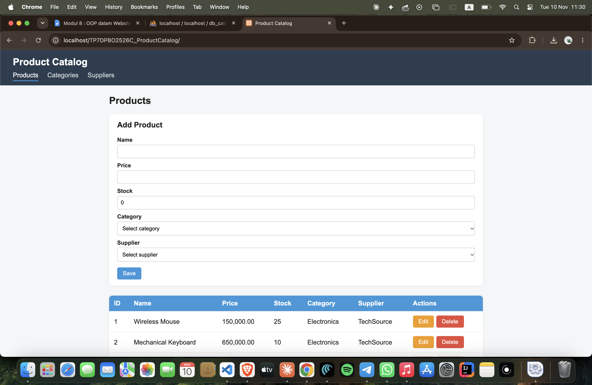
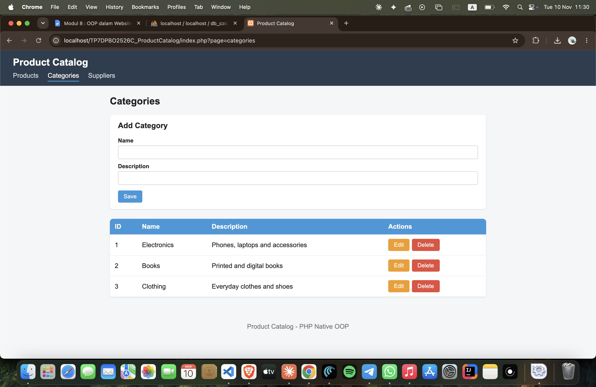
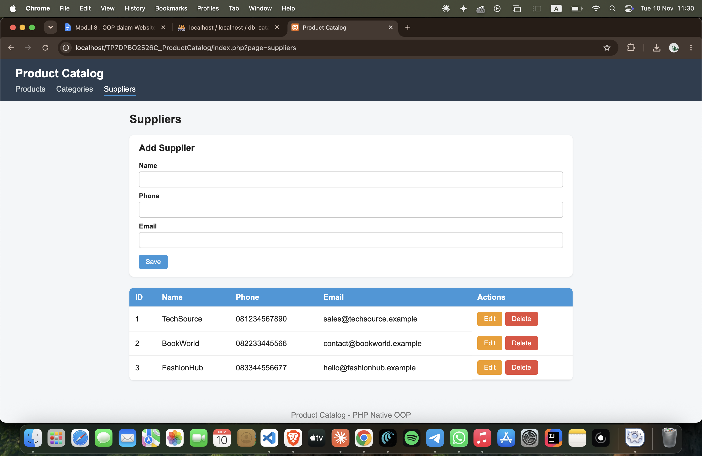

# TP7DPBO2526C1

# Product Catalog (PHP Native OOP)

Tugas Praktikum 7 DPBO 2026

Janji Saya Bozorov Huseyn (NIM: 2521812) mengerjakan evaluasi Tugas Praktikum 6 dalam mata kuliah Desain dan Pemrograman Berorientasi Objek untuk keberkahannya maka saya tidak melakukan kecurangan seperti yang telah dispesifikasikan. Aamiin.

A PHP Native web application that manages a product catalog using an object-oriented structure, PDO and prepared statements.

## Website Theme

The theme is a product catalog. Users can manage products, the categories those products belong to, and the suppliers that provide them. Every entity has full CRUD (Create, Read, Update, Delete).

## Database

The database is called db_catalog and contains three tables. The full structure and sample data are in database/db_catalog.sql.

categories stores product categories. Columns: id (primary key), name, description.

suppliers stores the companies that supply products. Columns: id (primary key), name, phone, email.

products stores the products. Columns: id (primary key), name, price, stock, category_id and supplier_id.

Relations: products.category_id is a foreign key to categories.id, and products.supplier_id is a foreign key to suppliers.id. Because of these foreign keys, a category or supplier that is still used by a product cannot be deleted, and the application shows an error message instead of crashing.

## Project Structure

class/ contains one class per table: Category.php, Supplier.php and Product.php. Each class receives the database connection in its constructor and holds the CRUD methods for its table.

config/ contains db.php with the Database class that creates the PDO connection.

database/ contains db_catalog.sql with the table structure and sample data.

view/ contains the HTML parts: header.php, footer.php, products.php, categories.php and suppliers.php.

index.php is the entry point of the application.

style.css contains the page styling.

## Code Flow

1. The browser sends a request to index.php, for example index.php?page=products.
2. index.php loads config/db.php and the classes, creates the PDO connection through the Database class, and creates one object for each class (Category, Supplier, Product).
3. The page parameter is checked against a whitelist (products, categories, suppliers). Any unknown value falls back to products.
4. If the request is a POST, index.php reads the action field (create, update or delete) and calls the matching method of the matching class. After a successful action it redirects back to the page with a success message (Post/Redirect/Get), which prevents duplicate submissions when the page is refreshed.
5. If the database refuses the action (for example deleting a category that still has products), the PDOException is caught and an error message is shown.
6. index.php then includes view/header.php, the view of the requested page, and view/footer.php.
7. The view asks the class objects for data (getAll, getById), and the class runs a prepared statement on the database and returns the rows as a PHP array.
8. The view turns the array into HTML. Clicking Edit reloads the page with ?edit=ID so the form is filled with the existing data, and submitting it sends the update action.
9. The finished HTML page is sent back to the browser as the response.

All queries use prepared statements with placeholders and bound values through PDO, so no raw query is executed directly and user input is never concatenated into SQL. All output in the views is escaped with htmlspecialchars.

## How to Run

1. Start Apache and MySQL (XAMPP, MAMP, Laragon) or install PHP and MySQL locally.
2. Import database/db_catalog.sql with phpMyAdmin or the mysql command line.
3. Check the credentials in config/db.php (host, database name, username, password).
4. Put the project folder in htdocs (XAMPP) or www (Laragon) and open it in the browser. Alternatively, run php -S localhost:8000 inside the project folder and open http://localhost:8000.

## Run Documentation

A screen recording of the website running, where CRUD is tried on all tables, is in the Dokumentasi folder.
Screen record - Screen Recording TP7.mp4

Products page:

Categories page:

Suppliers page:

